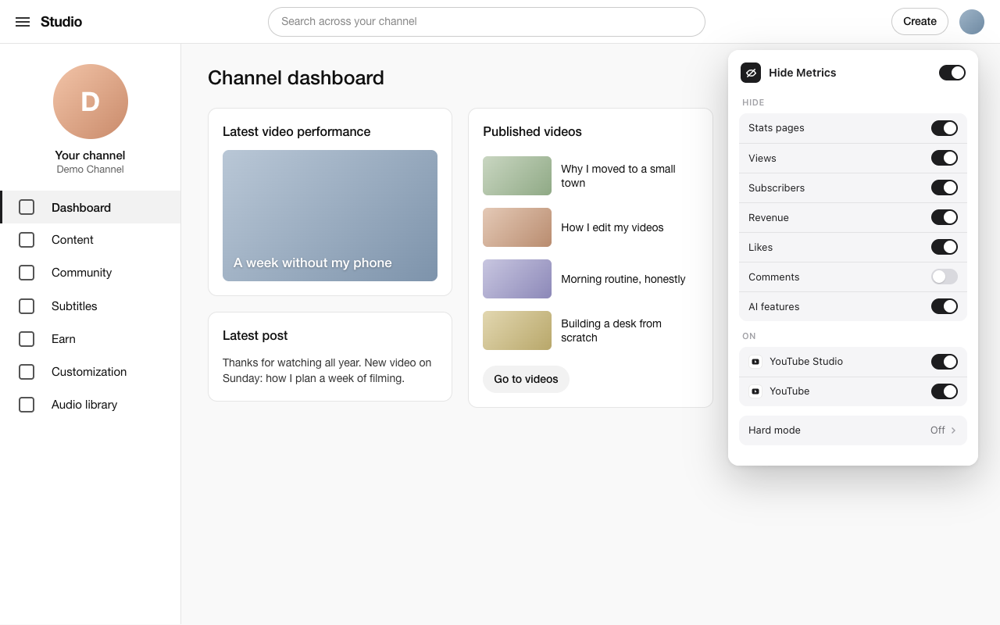

# Hide Metrics

A Chrome extension (Manifest V3) that hides the numbers on **YouTube Studio**
and **YouTube**: views, subscribers, likes, revenue, comment counts, stats
pages and AI prompts. Hidden things are simply gone: no grey bars, no blur, no
"show anyway" button.



## What it hides

Seven switches, each meaning the same thing on every site:

| Switch | YouTube Studio | YouTube |
|---|---|---|
| **Stats pages** | Insights (channel and per video), live subscriber count, realtime data, links to them | YouTube's own analytics URLs |
| **Views** | View counts, Channel analytics summary, top content, Views column | View counts on cards, watch page, Shorts, "watching" on lives |
| **Subscribers** | Current subscribers, live count, Recent subscribers card | Counts under videos, on channel pages, in search |
| **Revenue** | Estimated revenue (dashboard summary, Content column) | — |
| **Likes** | Like counts on videos, posts and comments | Like counts on videos, Shorts and comments |
| **Comments** *(off by default)* | Comment counts, Comments card, the comments inbox | Comment section and counts |
| **AI features** | Ask Studio, "Catch me up", AI suggestions, AI replies | "Ask" panel where present |

Under **On**, each site has its own switch. The switch at the top of the popup
pauses everything.

Where a number shares a line with other text and can't be separated by the
page's structure, the whole line is hidden. Nothing matches on words, so it
works in any language.

## Hard mode

Lock your choices until a date and time. While locked, switches only turn on,
the lock can only be extended, and the weekly check-in can't be moved. An
optional **weekly check-in** (for example Sunday 10:00 for 30 minutes) brings
the numbers back for that window; AI features stay hidden.

When you lock, Chrome asks for the optional "tabs" permission ("Read your
browsing history"). With it, opening the browser's extensions page during a
lock shows a "locked" page instead. Without it, the lock still works. Anyone
can still remove the extension from the toolbar menu; hard mode is a speed
bump, not a cage.

## Install

From the Chrome Web Store: _link coming after review_.

Or load it unpacked:

1. Open `chrome://extensions` (or `brave://extensions`, `edge://extensions`).
2. Turn on **Developer mode**.
3. Click **Load unpacked** and pick this folder.
4. Pin Hide Metrics from the puzzle-piece menu.

## Develop

No build step and no dependencies. Tests use Node's built-in runner (Node 20+):

```bash
npm test
```

Layout:

- `src/core/` — time math (`schedule.js`) and settings, lock rules and what is
  hidden right now (`state.js`). Pure functions, tested.
- `src/background.js` — the only writer of `chrome.storage.local`; enforces
  the lock even against edits made in DevTools; alarms for lock end and
  check-ins; the extensions-page guard.
- `src/content/` — `hide.js` (one `<style>` built from the switches, injected
  at `document_start` so nothing flashes), `block.js` (the page that replaces
  stats pages), `registry.js`.
- `src/sites/` — **everything site-specific**: one file per site with its URL
  rules and selectors per switch. A new site is a new file here plus a row
  under "On".
- `src/popup/`, `src/pages/` — popup, welcome and locked pages.

### When YouTube changes something

Selectors live only in `src/sites/youtube-studio.js` and `src/sites/youtube.js`.
To see which ones stopped matching:

1. Open the page where a number shows again.
2. Open DevTools → Console, and in the context menu at the top of the console
   pick **Hide Metrics**.
3. Run `HM.report(HM.current.site)`. Each selector shows how many elements it
   matches: `-1` means the selector is invalid; `0` on a page that has the
   thing means YouTube changed its markup.

To try selectors on a live page without reinstalling, paste the output of
`node scripts/dev-bundle.mjs` into the page's console, then use
`HM.devHide({ views: false })` to flip switches. Don't commit that output.

### Popup preview

```bash
python3 -m http.server 8765
```

Then open `http://localhost:8765/src/popup/popup.html` (add `?demo=locked`,
`?demo=checkin` or `?incognito=off`). Outside the extension it runs on an
in-memory stand-in.

### Release

```bash
python3 scripts/gen_icons.py
```

```bash
bash scripts/package.sh
```

`package.sh` writes `dist/hide-metrics-<version>.zip` with only the shipped
files. Store copy and permission justifications are in
[`STORE_LISTING.md`](STORE_LISTING.md).

**Store screenshots** come from a made-up channel, never a real Studio: serve
the repo as above, open `store/demo-studio.html?shot=dashboard` (also
`?shot=locked`, `?shot=blocked`) at 1280×800 in light mode, take a screenshot,
and normalize it with `python3 scripts/store_screenshot.py <png> dist/<name>.png`.

## Privacy

No data collected, no server, no network requests. Settings stay on this
device. See [PRIVACY.md](PRIVACY.md).

Not affiliated with YouTube or Google.
